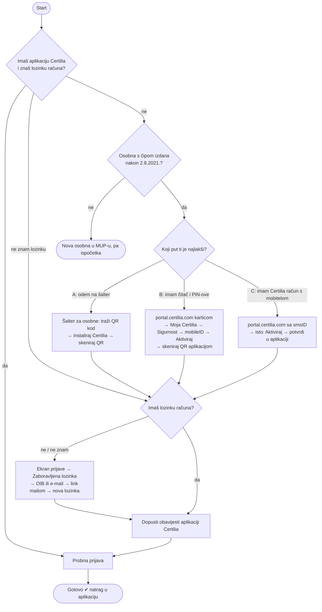

# Stablo odluka (hipoteza)

Stanje 2026-10-30: složeno iz baze znanja, prije analize videa. Svaki čvor
treba potvrditi izvorom (članak/video s vremenom) ili stvarnim prolaskom.

## Što svaki čvor treba potvrditi

| Čvor | Pretpostavka | Izvor dosad |
|---|---|---|
| Q2 | QR na šalteru samo za eOI izdane nakon 2.8.2021. | članak „QR kod za brzu aktivaciju" |
| A | Put bez računala i čitača; QR brzo istječe | isti članak; video `f675WcRwN4E` |
| A → L | **Nepoznato**: postoji li nakon QR aktivacije lozinka? | video `c7uD8aZsx3o`, `LIk8cLgybaA` |
| B | Portal prima prijavu karticom (x509) | `portal.certilia.com` nudi `x509CertificateAuthenticator` |
| C | smsID radi samo ako račun već ima broj mobitela | članak „aktivacija samo mobitelom" |
| R | Reset lozinke s OIB-om radi i s ekrana prijave aplikacije | članak „zaboravio sam lozinku… mobilnom vjerodajnicom" |
| O | Bez dozvole za obavijesti push ne stiže | članak „notifikacije mi ne stižu" |
| — | Aplikacija aktivna samo na jednom mobitelu | članak „više mobitela" |
| — | Istekom svih certifikata račun se briše | članak „istekli certifikati" |

Grane koje još treba istražiti: nema osobne s čipom (strani državljani,
stariji dokumenti), kartica bez PIN omotnice, FINA/kID kartica, eOI mobileID
na `mobile.eid.hr` (AKD-ova usluga, nije isto što i Certilia mobileID).
